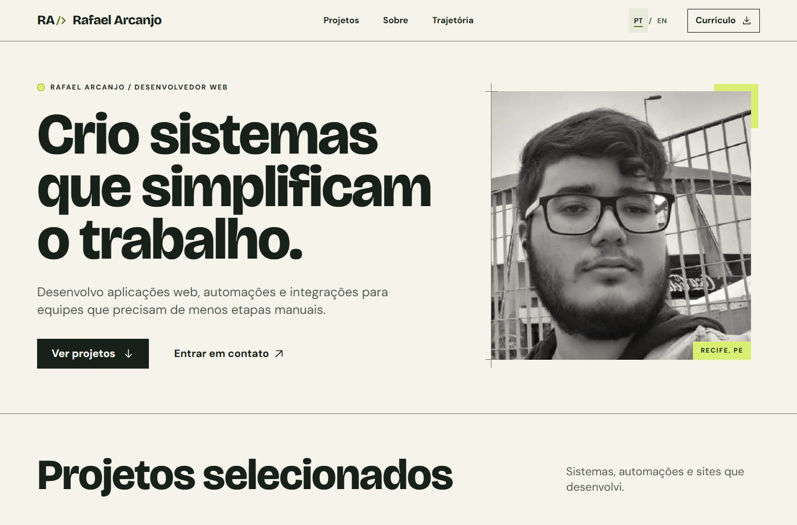
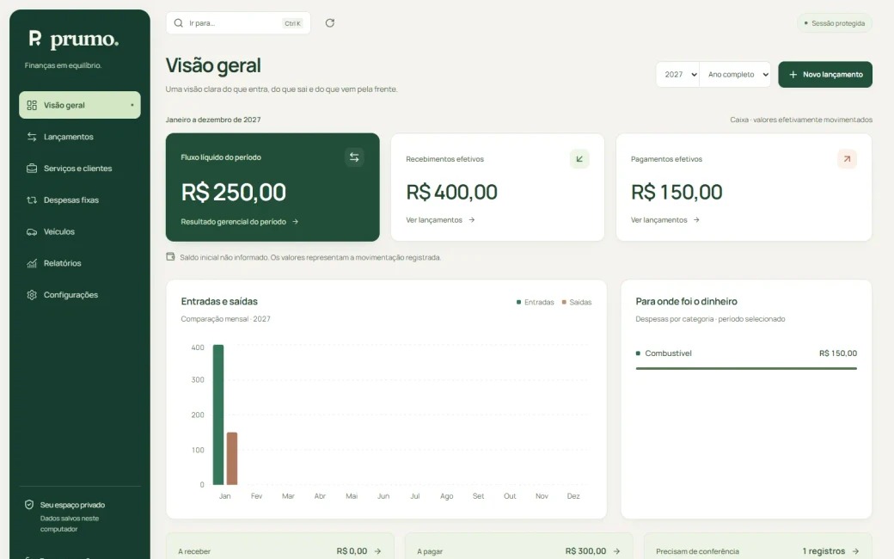
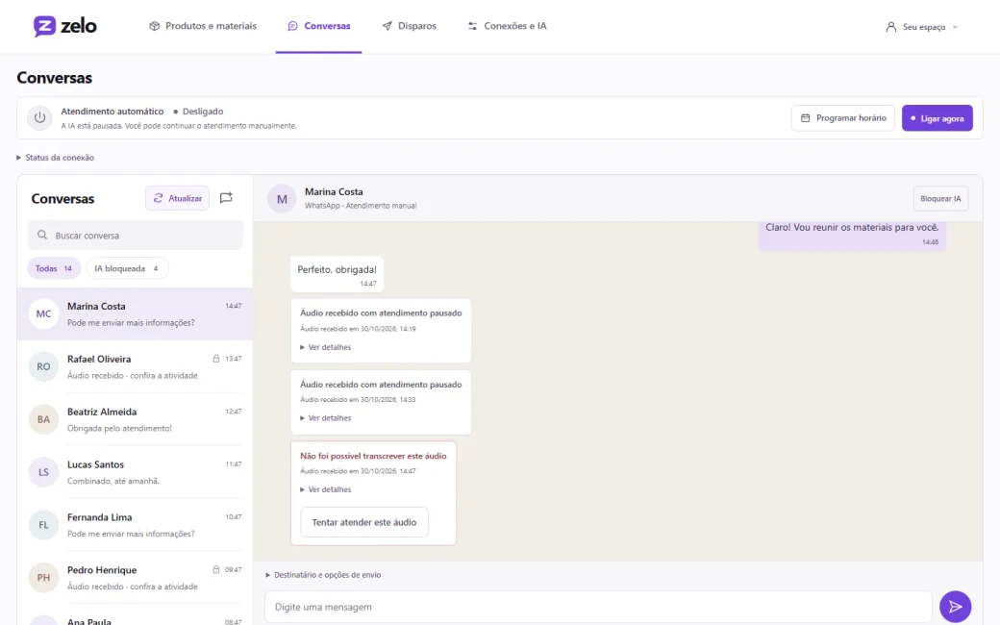

<div align="center">
  <h1>Rafael Arcanjo</h1>
  <p><strong>Desenvolvedor de Sistemas · Web, automação e IA aplicada</strong></p>
  <p>
    <a href="https://rafaeladsdev.com/"><strong>Portfólio ao vivo ↗</strong></a>
    · <a href="./curriculo.pdf">Currículo em PDF</a>
    · <a href="https://www.linkedin.com/in/rafaeladsdev">LinkedIn</a>
    · <a href="https://rafaeladsdev.com/#contact">Contato</a>
  </p>
</div>

[](https://rafaeladsdev.com/)

## Sobre mim

Desenvolvo sistemas na **Claivor** e sou sócio da **Vercuno**. Sou formado em Análise e Desenvolvimento de Sistemas pela Faculdade Senac PE. Trabalho com aplicações web, automações e integrações que simplificam tarefas do dia a dia.

Neste portfólio estão **15 projetos**, minha trajetória profissional, formação, certificados e currículo. O site está disponível em **português e inglês**. [Trajetória profissional](https://rafaeladsdev.com/#experience) · [Tecnologias e ferramentas](https://rafaeladsdev.com/#stack)

## Projetos selecionados

<table>
  <tr>
    <td width="50%" valign="top">
      <a href="https://vercuno.com.br/portfolio/prumo"></a>
      <h3>Prumo Financeiro</h3>
      <p>Gestão financeira com fluxo de caixa, cadastro de clientes e agenda de serviços.</p>
      <p><sub><strong>Next.js · TypeScript · Prisma</strong></sub></p>
      <p><a href="https://vercuno.com.br/portfolio/prumo">Estudo de caso</a> · <a href="https://github.com/RafaelADSdev/prumo">Código-fonte</a></p>
    </td>
    <td width="50%" valign="top">
      <a href="https://vercuno.com.br/portfolio/zelo"></a>
      <h3>Zelo</h3>
      <p>Atendimento via WhatsApp com catálogo, histórico de conversas e respostas automatizadas.</p>
      <p><sub><strong>Node.js · WhatsApp · PWA</strong></sub></p>
      <p><a href="https://vercuno.com.br/portfolio/zelo">Estudo de caso</a> · <a href="https://github.com/RafaelADSdev/Zelo">Código-fonte</a></p>
    </td>
  </tr>
</table>

| Projeto | O que foi entregue |
| --- | --- |
| [Vercuno](https://vercuno.com.br/) | Site da empresa com serviços e estudos de caso sobre produtos digitais. |
| [Suzzy Alves Fotografia](https://fotografia-flax.vercel.app/) | Portfólio de ensaios com galerias por categoria e agendamento pelo WhatsApp. |
| [Psicologia Caio](https://psicologocaio.vercel.app/) | Site institucional para apresentar o psicólogo e facilitar o contato para atendimento online. |
| [Náutica Engenharia](https://nauticaengenharia.vercel.app/) | Site de serviços de engenharia, com projetos e solicitação de orçamento pelo WhatsApp. |

O arquivo do portfólio reúne outros nove trabalhos corporativos e acadêmicos, incluindo **Flow Focus**, **Central de Demandas** e **HubCore Dashboard**, com filtros de front-end e dados/BI. [Explorar o arquivo de projetos](https://rafaeladsdev.com/#archive)

## Como o portfólio foi feito

O site usa **HTML, CSS e JavaScript nativos**. O **PHP** recebe e valida as mensagens do formulário, e a **Hostinger** publica o conteúdo da branch `main`. As fontes Bricolage Grotesque e DM Sans são servidas pelo próprio site, e as capturas de projetos usam WebP.

| Arquivo | Onde editar |
| --- | --- |
| [`index.html`](./index.html) | Projetos, trajetória, formação, certificados e contato. |
| [`i18n.js`](./i18n.js) | Textos em português e inglês, metadados e rótulos acessíveis. |
| [`style.css`](./style.css) | Layout responsivo, cores, tipografia e estados de interação. |
| [`script.js`](./script.js) e [`disclosures.js`](./disclosures.js) | Navegação, filtros, seções expansíveis e envio do formulário. |
| [`send-contact.php`](./send-contact.php) | Validação das mensagens e envio por e-mail. |
| [`curriculo.html`](./curriculo.html) e [`curriculo.pdf`](./curriculo.pdf) | Versão web do currículo e arquivo para download. |

## Rodar localmente

Com **Git e PHP 8.1 ou superior**, clone o repositório e suba o servidor integrado do PHP. A página abre sem instalar dependências de front-end ou rodar build.

```bash
git clone https://github.com/RafaelADSdev/Site-curriculo-.git portfolio-rafael
cd portfolio-rafael
php -S 127.0.0.1:8000 -t .
```

Abra [http://127.0.0.1:8000](http://127.0.0.1:8000/).

### Configurar o formulário

Na Hostinger, use [`config.example.php`](./config.example.php) como modelo para criar `config.php` ao lado de `send-contact.php`. Preencha `CONTACT_EMAIL_TO` com os destinatários, `CONTACT_EMAIL_FROM` com um remetente do domínio e, se desejar, `CONTACT_FROM_NAME` com o nome exibido no e-mail. O PHP também aceita essas três configurações por variáveis de ambiente. Mantenha `config.php` fora do Git.

<details>
  <summary><strong>Testar o envio no Windows com Mailpit</strong></summary>

Com o [Mailpit](https://mailpit.axllent.org/) em execução, use estes comandos no PowerShell a partir da raiz do projeto.

```powershell
$env:CONTACT_EMAIL_TO = 'contato@example.test'
$env:CONTACT_EMAIL_FROM = 'portfolio@example.test'
$env:CONTACT_PREVIEW = '1'
php -d SMTP=127.0.0.1 -d smtp_port=1025 -S 127.0.0.1:8000 -t .
```

O formulário indica que a mensagem foi recebida em teste. Confira o assunto, o conteúdo e o endereço de resposta na [caixa local do Mailpit](http://127.0.0.1:8025/).

</details>

## Contato

[rafaelarcanjods05@gmail.com](mailto:rafaelarcanjods05@gmail.com) · [LinkedIn](https://www.linkedin.com/in/rafaeladsdev) · [GitHub](https://github.com/RafaelADSdev)
